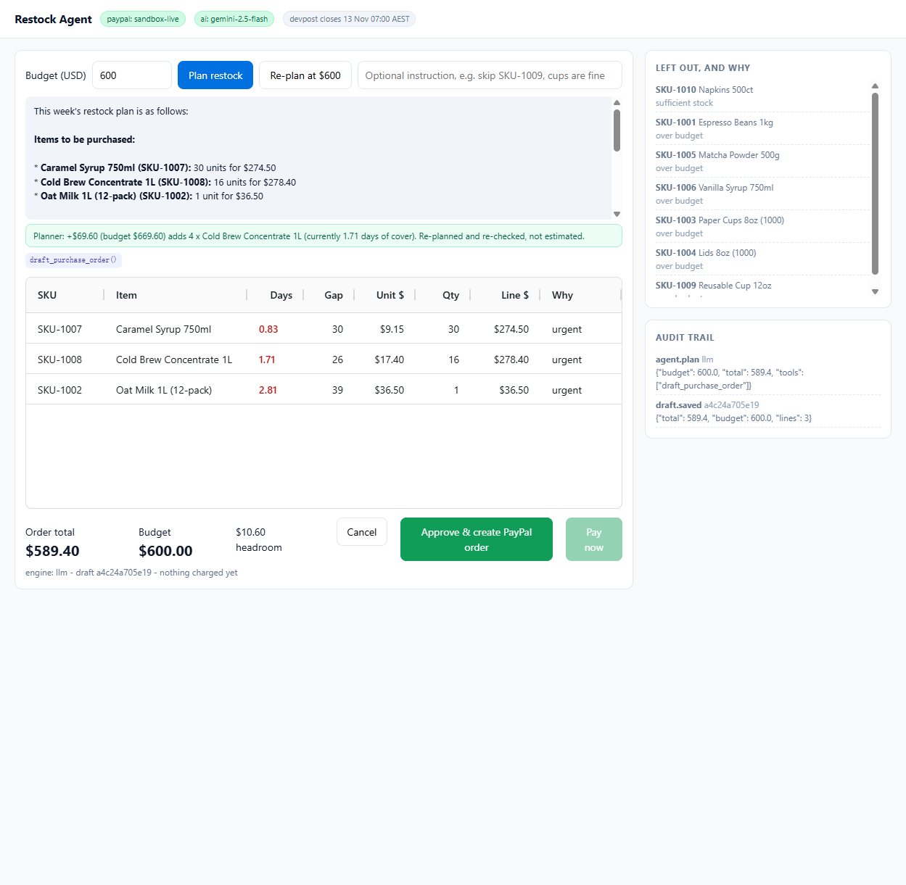
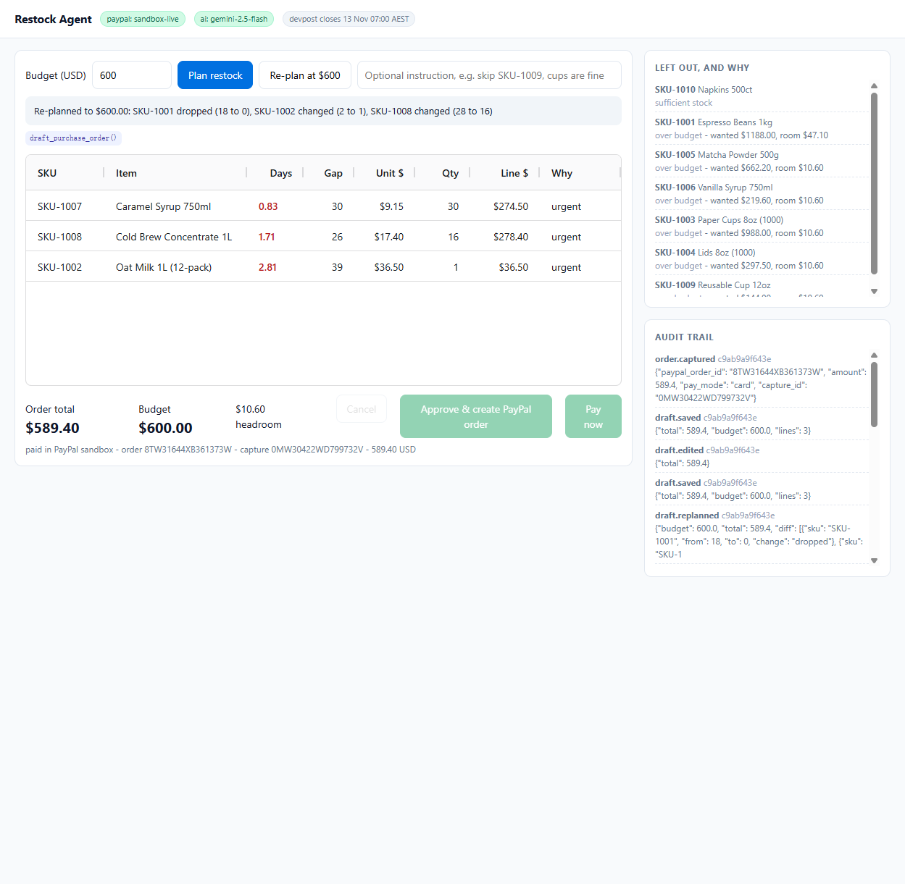

# Restock Agent

**An agentic replenishment buyer for small merchants.** It reads the shop's stock CSV, prices the
supplier catalog, drafts a purchase order that cannot exceed a hard budget, and **pays the supplier
through PayPal Orders v2 inside a spending limit the merchant sets once** — with no human click on
the payment. Over the limit, the server refuses and a person decides.

Built for the [PayPal AI Hackathon](https://paypalaihackathon.devpost.com/) (Best Use of Agentic Commerce).



---

## Judge's map: where to look for each criterion

| Criterion | What to look at |
|---|---|
| **Technological Implementation** | `app/paypal_client.py` (Orders v2 + token refresh + reconciliation), `app/service.py` (approval token, atomic claim, policy check), `tests/test_boundaries.py` (23 cases, no network). Real captures are reconciled against PayPal in [`EVIDENCE.md`](EVIDENCE.md) — regenerate with `python -m scripts.audit_evidence`. |
| **Design** | One screen, one decision: three KPIs at the top answer *what stocks out / what this order costs / what demand is not covered*; the draft table is editable; the green strip quotes the next purchase and its exact price with a button that re-plans. |
| **Potential Impact** | A café reordering ten SKUs weekly either stocks out on a Friday or ties up cash in the wrong items. §[The problem](#the-problem). |
| **Innovation** | The agent does not *suggest* a restock; it **prices the trade-off** and pays. `next_unlock` is re-computed and re-checked at the higher budget (`app/planner.py`), so "add $69.60 and you get four more cases" is verified, not guessed. |
| **Presentation** | 68-second demo: one click → paid (capture id on screen) → the trade-off button → the limit refusing it → PayPal confirming the payment. Narrated, captions state the sandbox and declare the cut waits. |

---

## Two payment modes (this is where PayPal's rules bite)

PayPal will not let a merchant capture an order the payer never approved, so the integration
supports both paths and picks one by env var:

| `PAYPAL_PAYMENT_MODE` | What happens | When to use |
|---|---|---|
| `card` (default) | the agent holds a sandbox card on file, sends `payment_source.card` when creating the order, and PayPal settles inside that single call (`COMPLETED` + capture id) | autonomous agent checkout; headless demo; CI |
| `approval` | the order is created without a payment source, the app surfaces the `checkoutnow?token=…` approval link, the payer approves in the PayPal sandbox, then `POST /api/capture` settles it | human-in-the-loop checkout, if a judge wants to click through PayPal |

Both paths end in the same place: a real sandbox capture that can be checked against PayPal.
[`EVIDENCE.md`](EVIDENCE.md) holds the reconciliation for every payment this repo claims:

```
1S175593S0202690C  status=COMPLETED  capture=6G4474502P272802R  589.40 USD  -> OK   (agent, no human)
6JB53388V74529227  status=COMPLETED  capture=14A20069V5594282Y  659.00 USD  -> OK   (human approved)
```

The very first attempt without a payment source was refused with `422 UNPROCESSABLE_ENTITY /
ORDER_NOT_APPROVED`, which is the documented behaviour and is what the `approval` mode is for.



---

## The problem

A café with ten SKUs and a weekly restock has to answer three questions that no spreadsheet answers
well: *what will run out before the next delivery*, *what do I cut when the budget shrinks*, and
*what did I actually pay for*. Today that is 40 minutes of arithmetic plus a manual checkout, and the
arithmetic silently rots: one forgotten SKU means a stockout, one stale price means a wrong payment.

Restock Agent turns that into one screen and one approval.

## What it does

1. **Read** — `read_inventory` loads `data/inventory.csv`: on-hand, daily sales, supplier lead time,
   safety-stock days, MOQ.
2. **Quote** — `quote_catalog` pulls live unit prices for the SKUs it is about to buy.
3. **Draft** — `draft_purchase_order(budget)` computes a gap per SKU
   (`daily_sales × (lead_time + safety_days) − on_hand`), sorts by days-of-cover, and allocates the
   budget greedily. Anything that does not fit is reported with the exact shortfall — never dropped
   silently.
4. **Re-plan** — change the budget and the same tool runs again, returning a diff of what was
   dropped, added or resized. This is the agent acting, not a suggestion engine.
5. **Price the trade-off** — every draft carries `next_unlock`: the single next purchase worth
   making and what it costs. If a line was trimmed by the budget it quotes one more MOQ of that
   line; otherwise it quotes the cheapest budget increase that brings a skipped SKU back. Each
   answer is produced by re-running the allocator at the higher budget, so the number on screen is
   verified rather than estimated (`tests/test_boundaries.py::test_skipped_items_price_the_trade_off`).
6. **Pay — and this is the point** — two paths, one of which has no human in it:
   - **Standing limit (default)**: the merchant sets "auto-pay up to $X" once. `POST /api/run`
     plans **and pays** inside that limit with no further human step. That is the agentic part:
     nobody clicks a pay button.
   - **Human approval**: when a draft exceeds the limit the server refuses it
     (`over_policy_limit`), keeps the draft editable, and asks for a one-off approval token scoped
     to that exact total. The agent proposes; a person decides.

The agent never sees either authorisation — the policy check lives in `service.create_order`, not in
the UI, so no caller can talk its way past it. The reply text is also sanitised: the model is not
allowed to claim whether payment happened, because settlement is decided after it returns.

## Guardrails (the part judges should test)

| Guard | Behaviour |
|---|---|
| **Standing limit** | `POST /api/run` settles only if `total ≤ autopay_limit`. The limit is compared against the draft's real total server-side; a caller that lies about the limit gets `over_policy_limit` |
| **Approval token** | out-of-policy drafts need `HMAC(secret, draft_id : total : line_count)`. Editing a quantity changes the total and invalidates every token issued before the edit |
| **The model cannot set its own budget** | `budget_usd` is not a tool parameter. The ceiling lives in server-side session state; if the model tries to send a budget anyway it is logged as `agent.budget_override_refused` and ignored. An assertion fails loudly if a draft ever carries a different ceiling |
| **The model cannot pay** | `pay_purchase_order` is not in the tool schema the model sees, and the dispatcher raises `PermissionError` if it is called anyway. Money moves only from the human Approve click |
| Catalog price drift | if the supplier price moved since the draft, the order is refused with a `price_drift` error and the draft must be re-planned |
| Idempotency | `PayPal-Request-Id` on create, stable key on capture; a double click returns the first capture with `deduplicated: true` |
| Crash recovery | before every capture the order is re-read from PayPal. If it was already charged while our write was lost, the local row is repaired from that response instead of charging again (`order.reconciled`) |
| Concurrent approve | `claim_for_payment` moves the draft to `approving` inside one `BEGIN IMMEDIATE` transaction; a second caller loses the race and gets `illegal_transition` |
| State machine | `draft → awaiting_capture → paid`, `→ cancelled`; illegal transitions raise `illegal_transition`, and a paid order can never be cancelled |
| Empty / zero drafts | an empty order is refused |

`tests/test_boundaries.py` covers all of them, offline, with no credentials (14 tests).

## Architecture

```
browser (AG Grid, single screen)
   │  fetch JSON
   ▼
FastAPI  app/main.py ── agent.plan() ──► LLM tool-calling loop (app/agent.py)
   │                                        │ tools: read_inventory / quote_catalog
   │                                        │        draft_purchase_order / pay_purchase_order
   │                                        ▼
   │                                   app/planner.py   (pure gap + allocation math)
   │                                   app/catalog.py   (CSV + JSON loaders)
   ├── app/service.py  ── guards ──► app/paypal_client.py ──► api-m.sandbox.paypal.com
   └── app/store.py    (SQLite: drafts, orders, append-only audit log)
```

Two design choices worth naming:

- **The math is deterministic and separate from the model.** The LLM chooses *which* tools to call and
  *how to explain* the result; it never computes a dollar amount. Every number in the UI is
  re-derivable from `planner.py`, so the audit trail is trustworthy.
- **A mock PayPal client ships in the box.** Without credentials the app runs end-to-end against
  `MockPayPal`, which keeps tests and demos reproducible and offline.

## Run it

```bash
python -m venv .venv && .venv\Scripts\activate     # Windows
pip install -r requirements.txt
copy .env.example .env                              # then fill in the values
python -m uvicorn app.main:app --host 127.0.0.1 --port 8756
```

Open <http://127.0.0.1:8756/>.

Sandbox credentials come from <https://developer.paypal.com/dashboard/applications/sandbox>
(App → Client ID / Secret). With them present the header badge reads `paypal: sandbox-live` and the
approve step returns a real `sandbox.paypal.com/checkoutnow?token=…` link; without them it reads
`paypal: mock`.

Verify credentials alone:

```bash
python -m scripts.smoke --token-check
```

Full local run (plan → approve → capture) with an audit trail dump:

```bash
python -m scripts.smoke --budget 1200
python -m unittest discover -s tests -v
```

### Environment

| Variable | Purpose |
|---|---|
| `PAYPAL_CLIENT_ID` / `PAYPAL_CLIENT_SECRET` | sandbox app credentials (never commit) |
| `PAYPAL_BASE_URL` | defaults to `https://api-m.sandbox.paypal.com` |
| `PAYPAL_CURRENCY` | defaults to `USD` |
| `PAYPAL_PAYMENT_MODE` | `card` (default) or `approval` — see above |
| `LLM_BASE_URL` / `LLM_API_KEY` / `LLM_MODEL` | any OpenAI-compatible endpoint; blank ⇒ deterministic planner |
| `RESTOCK_DB` | SQLite path, defaults to `data/restock.db` |

## Tools used

| Tool | How it is used |
|---|---|
| **PayPal Orders v2 REST API** (sandbox) | `POST /v2/checkout/orders` to create, `POST /v2/checkout/orders/{id}/capture` to capture; `POST /v1/oauth2/token` with automatic token refresh (sandbox tokens live 3–8 h) |
| **Google Gemini 2.5 Flash** via its OpenAI-compatible endpoint | function calling decides which tools to call, in what order, and how to explain cuts after a budget change. Any OpenAI-compatible provider works; the model name is shown in the header badge. If the provider is unreachable the run is labelled `llm-fallback` and the deterministic planner finishes the job, so the demo never dies on stage |
| **AG Grid Community** (MIT) | the single-screen review table: editable quantities, live line totals, budget headroom |
| **FastAPI + SQLite** | HTTP surface, SQLite for drafts/orders plus an append-only event log |

No PayPal credentials, tokens or account data are written to the repository; `.env` is gitignored
and `.env.example` carries only empty keys.

## Demo script (2:40, matches the video)

| Time | Beat |
|---|---|
| 0:00–0:20 | The shop, the CSV, the question: "what runs out before Thursday?" |
| 0:20–0:55 | Plan at $1200 → four lines, six SKUs left out with reasons |
| 0:55–1:25 | Cut to $600 → diff shows `SKU-1001 dropped`, `SKU-1008 28 → 16` |
| 1:25–1:55 | Edit a quantity in the grid → total and headroom recompute |
| 1:55–2:20 | Approve → PayPal order + real sandbox approval link → pay → capture id |
| 2:20–2:40 | Click pay twice: `deduplicated: true`. Raise the price in the catalog: `price_drift`. Audit log. |

## Limitations

- One merchant, one currency (USD), one supplier catalog — deliberate scope for a 6-day build.
- The catalog is a local JSON file standing in for a supplier API; the sandbox products are not
  provisioned through PayPal Catalog yet.
- Capture is server-side (merchant-initiated) rather than a buyer-approved redirect; the approval URL
  is surfaced in the UI for transparency but the demo uses the direct capture path.

## License

MIT — see [LICENSE](LICENSE).
