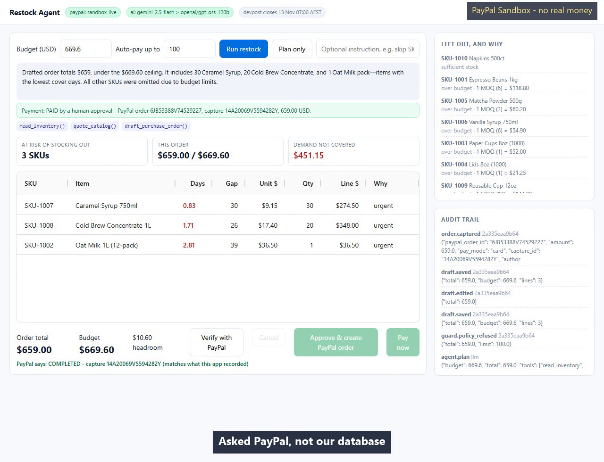

# Restock Agent

**An agentic replenishment buyer for small merchants.** It reads the shop's stock CSV, prices the
supplier catalog, drafts a purchase order that cannot exceed a hard budget, and **pays the supplier
through PayPal Orders v2 inside a spending limit the merchant sets once** - with no human click on
the payment. Over that limit, the server refuses and a person decides.

Built for the [PayPal AI Hackathon](https://paypalaihackathon.devpost.com/).


---

## Judge's map: where to look for each criterion

| Criterion | What to look at |
|---|---|
| **Technological Implementation** | `app/paypal_client.py` (Orders v2, token refresh, reconciliation), `app/service.py` (approval token, atomic claim, policy check re-verified after the claim), `tests/test_boundaries.py` (25 cases, no network, no credentials). Every claimed capture is reconciled against PayPal itself in [`EVIDENCE.md`](EVIDENCE.md) - regenerate with `python -m scripts.audit_evidence`. |
| **Design** | One screen, one decision. Three KPIs answer *what stocks out / what this order costs / what demand is not covered*; the draft table is editable; the green strip quotes the next purchase and its exact price, with a button that re-plans and delivers it. |
| **Potential Impact** | A cafe reordering ten SKUs weekly either stocks out on a Friday or ties up cash in the wrong items. See [The problem](#the-problem). |
| **Innovation** | The agent does not *suggest* a restock; it **prices the trade-off** and pays. `next_unlock` is produced by re-running the allocator at the higher budget, so "add $69.60 and you get four more cases" is verified, not guessed (`app/planner.py`). |
| **Presentation** | 68-second demo: one click, paid with a capture id on screen; the trade-off button; the limit refusing a purchase; PayPal confirming it. Captions state the sandbox and declare the cut waits. |

---

## Two payment modes (this is where PayPal's rules bite)

PayPal will not let a merchant capture an order the payer never approved, so the integration
supports both paths and picks one by env var:

| `PAYPAL_PAYMENT_MODE` | What happens | When to use |
|---|---|---|
| `card` (default) | the agent holds a sandbox card on file, sends `payment_source.card` when creating the order, and PayPal settles inside that single call (`COMPLETED` + capture id) | autonomous agent checkout; headless demo; CI |
| `approval` | the order is created without a payment source, the app surfaces the `checkoutnow?token=...` approval link, the payer approves in the sandbox, then `POST /api/capture` settles it | human-in-the-loop checkout |

Both end in the same place: a real sandbox capture that can be checked against PayPal.
[`EVIDENCE.md`](EVIDENCE.md) holds that reconciliation for every payment this repo claims:

```
1S175593S0202690C  status=COMPLETED  capture=6G4474502P272802R  589.40 USD  OK  (agent, no human)
6JB53388V74529227  status=COMPLETED  capture=14A20069V5594282Y  659.00 USD  OK  (human approved)
```

The very first attempt without a payment source was refused with `422 UNPROCESSABLE_ENTITY /
ORDER_NOT_APPROVED` - documented behaviour, and the reason `approval` mode exists.


The last beat of the demo asks PayPal directly instead of trusting this app's own database:



---

## The problem

A cafe with ten SKUs and a weekly restock has to answer three questions that no spreadsheet answers
well: *what will run out before the next delivery*, *what do I cut when the budget shrinks*, and
*what did I actually pay for*. That is arithmetic plus a manual checkout, and the arithmetic rots
silently: one forgotten SKU means a stockout, one stale price means a wrong payment.

**Assumption, not a measurement:** the "about 40 minutes a week" figure is my estimate of doing this
by hand, not something I timed with a merchant.

Restock Agent turns it into one screen and one decision.

## What it does

1. **Read** - `read_inventory` loads `data/inventory.csv`: on-hand, daily sales, supplier lead time,
   safety-stock days, MOQ.
2. **Quote** - `quote_catalog` pulls live unit prices for the SKUs it is about to buy.
3. **Draft** - `draft_purchase_order` computes a gap per SKU
   (`daily_sales * (lead_time + safety_days) - on_hand`), sorts by days-of-cover, and allocates the
   budget greedily. Anything that does not fit is reported with the exact shortfall - never dropped
   silently.
4. **Re-plan** - change the budget and the same tool runs again, returning a diff of what was
   dropped, added or resized. This is the agent acting, not a suggestion engine.
5. **Price the trade-off** - every draft carries `next_unlock`: the single next purchase worth
   making and what it costs. If a line was trimmed by the budget it quotes one more MOQ of that
   line; otherwise it quotes the cheapest budget increase that brings a skipped SKU back. Each
   answer is produced by re-running the allocator at the higher budget, and the test suite fails if
   the quoted delta does not actually buy the thing.
6. **Pay** - two paths, and the difference is the point:
   - **Standing limit (default)**: the merchant sets `AUTOPAY_LIMIT_USD` once, on the server.
     `POST /api/run` plans **and pays** inside it with no further human step. Nobody clicks a pay
     button. The limit is not a request field, so a caller cannot raise it by asking.
   - **Human approval**: above the limit the server refuses (`over_policy_limit`), keeps the draft
     editable, and asks for a one-off approval token scoped to that exact total. The agent proposes;
     a person decides.

The agent never sees either authorisation - the policy check lives in `service.create_order`, not in
the UI, and it is re-checked against the draft that was actually claimed. The reply text is also
sanitised: the model may not claim whether payment happened, because settlement is decided after it
returns.

## Guardrails (the part judges should test)

| Guard | Behaviour |
|---|---|
| **Standing limit** | `POST /api/run` settles only if `total <= AUTOPAY_LIMIT_USD`, taken from server config. Sending `autopay_limit_usd` in the request has no effect. |
| **Re-check after claim** | the limit is verified again against the draft version that was actually claimed; a mismatch releases the claim and refuses |
| **Approval token** | out-of-policy drafts need `HMAC(secret, draft_id : total : line_count)`. Editing a quantity changes the total and invalidates every token issued before the edit |
| **The model cannot set its own budget** | `budget_usd` is not a tool parameter. The ceiling lives in server-side session state; if the model sends one anyway it is logged (`agent.budget_override_refused`) and ignored, and an assertion fails if a draft ever carries a different ceiling |
| **The model cannot pay** | `pay_purchase_order` is not in the schema the model sees, and the dispatcher raises `PermissionError` if called anyway |
| **Catalog price drift** | if the supplier price moved since the draft, the order is refused with `price_drift` |
| **Idempotency** | `PayPal-Request-Id` on create, stable key on capture; a double click returns the first capture with `deduplicated: true` |
| **Crash recovery** | before every capture the order is re-read from PayPal; a charge whose local write was lost is repaired from PayPal's answer instead of being charged twice |
| **Concurrent approve** | `claim_for_payment` moves the draft to `approving` inside one `BEGIN IMMEDIATE` transaction; a second caller loses the race |

`tests/test_boundaries.py` covers all of them, offline, with no credentials (25 tests).

## Architecture

```
browser (AG Grid, single screen)
   |  fetch JSON
   v
FastAPI  app/main.py -- agent.plan() --> LLM tool-calling loop (app/agent.py)
   |                                        | tools: read_inventory / quote_catalog
   |                                        |        draft_purchase_order
   |                                        v
   |                                   app/planner.py   (pure gap + allocation math)
   |                                   app/catalog.py   (CSV + JSON loaders)
   +-- app/service.py -- guards --> app/paypal_client.py --> api-m.sandbox.paypal.com
   +-- app/store.py   (SQLite: drafts, orders, append-only audit log)
```

Two design choices worth naming:

- **The math is deterministic and separate from the model.** The LLM chooses which tools to call and
  how to explain the result; it never computes a dollar amount. Every number in the UI is
  re-derivable from `planner.py`, so the audit trail is trustworthy.
- **A mock PayPal client ships in the box.** Without credentials the app runs end-to-end against
  `MockPayPal`, which keeps tests and demos reproducible and offline.

## Run it

```bash
python -m venv .venv && .venv\Scripts\activate     # Windows
pip install -r requirements.txt
copy .env.example .env                              # then fill in the values
python -m uvicorn app.main:app --host 127.0.0.1 --port 8756
```

Open <http://127.0.0.1:8756/>.

Sandbox credentials come from <https://developer.paypal.com/dashboard/applications/sandbox>
(App -> Client ID / Secret). With them present the header badge reads `paypal: sandbox-live` and a
payment produces a real sandbox capture; without them it reads `paypal: mock` and nothing leaves the
machine.

Verify credentials alone:

```bash
python -m scripts.smoke --token-check
```

Full local run (plan -> approve -> capture) with an audit trail dump:

```bash
python -m scripts.smoke --budget 1200
python -m unittest discover -s tests -v
python -m scripts.audit_evidence        # asks PayPal about every recorded payment
```

### Environment

| Variable | Purpose |
|---|---|
| `PAYPAL_CLIENT_ID` / `PAYPAL_CLIENT_SECRET` | sandbox app credentials (never commit) |
| `PAYPAL_BASE_URL` | defaults to `https://api-m.sandbox.paypal.com` |
| `PAYPAL_CURRENCY` | defaults to `USD` |
| `PAYPAL_PAYMENT_MODE` | `card` (default) or `approval` |
| `AUTOPAY_LIMIT_USD` | default for the merchant's standing spend limit. The value the app actually honours is stored on the server (`POST /api/policy`, written by the UI once) and this env var is only the fallback. It is never accepted from a payment request |
| `LLM_BASE_URL` / `LLM_API_KEY` / `LLM_MODEL` | any OpenAI-compatible endpoint; blank means the deterministic planner |
| `LLM2_*` | optional second provider, used when the first is rate limited or down |
| `RESTOCK_DB` | SQLite path, defaults to `data/restock.db` |

## Tools used

| Tool | How it is used |
|---|---|
| **PayPal Orders v2 REST API** (sandbox) | `POST /v2/checkout/orders` to create, `POST /v2/checkout/orders/{id}/capture` to capture, `GET /v2/checkout/orders/{id}` to reconcile; `POST /v1/oauth2/token` with automatic token refresh (sandbox tokens live 3-8 h) |
| **LLM with function calling** | decides which tools to call, in what order, and how to explain cuts after a budget change. Two providers in a chain (Gemini, then Groq) so a 20-requests/day free tier cannot take the demo offline; a hard provider error also falls through. If every provider fails the run is labelled `llm-fallback` and the deterministic planner finishes |
| **AG Grid Community** (MIT) | the single-screen review table: editable quantities, live line totals, budget headroom |
| **FastAPI + SQLite** | HTTP surface, plus an append-only event log that records what authorised each payment |

No PayPal credentials, tokens or account data are written to the repository; `.env` is gitignored
and `.env.example` carries only empty keys.

## The 68-second demo

This is the submitted cut, not a plan:

| Time | What is on screen |
|---|---|
| 0:00 | Title card, crediting the work: "AI narration - script, build and voice direction by Songquan Chen" |
| 0:03 | Budget 600 and the standing limit 700 (server), then a single click on Run |
| 0:22 | `PAID AUTOMATICALLY` with order id, capture id and $589.40; a persistent `PayPal Sandbox - no real money` badge; the audit log showing `policy.auto_approve` |
| 0:32 | The trade-off button is pressed: budget becomes $669.60 and cold brew goes 16 -> 20 |
| 0:42 | The limit is dropped to $100 and the same run is refused: `STOPPED`, `guard.policy_refused` in the log |
| 0:50 | A human approves that one, producing a second capture |
| 0:58 | `Verify with PayPal` returns `COMPLETED` with the same capture id this app recorded |
| 1:06 | End card: repo, 25 tests, MIT |

The two real model waits are cut, and the cuts are declared on screen
(`~40s of real model time omitted`) rather than hidden.

## Limitations

- One merchant, one currency (USD), one supplier catalog - deliberate scope for a short build.
- The catalog is a local JSON file standing in for a supplier API; products are not provisioned
  through PayPal Catalog yet.
- The standing limit is per payment, not a cumulative daily or weekly cap. That is the next thing
  a real merchant would ask for, and it is not built.
- The model's reasoning is observable through the tool trace and the audit log, but not evaluated:
  nothing here proves it picked the *best* restock, only that it made the decision and can explain it.

## License

MIT - see [LICENSE](LICENSE).
